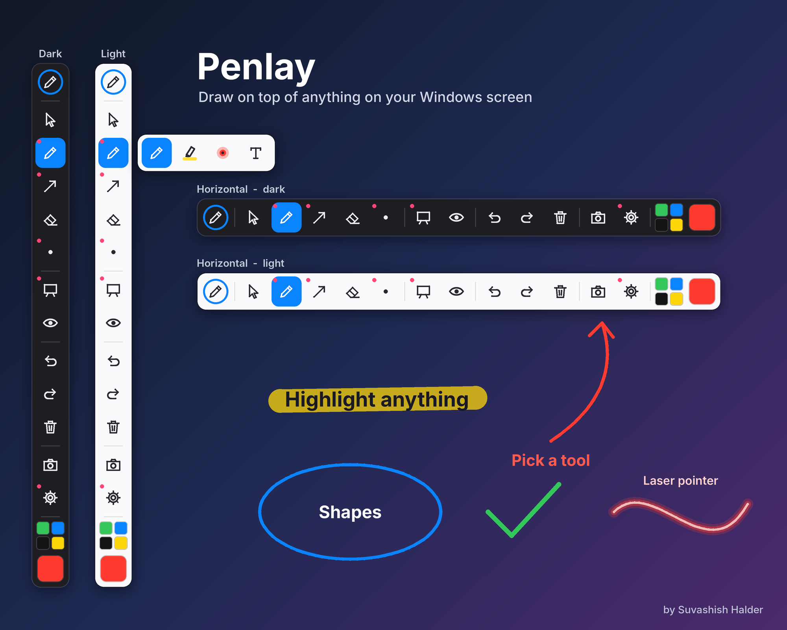

# Penlay

**Draw on top of anything on your Windows screen.**

Pen, highlighter, laser pointer, shapes, text, whiteboard and screenshots, all from one small toolbar.

[**Download the latest version**](https://github.com/suvashishfx/penlay/releases/latest)

---

## Features

- **Draw over any app**: charts, browsers, slides, videos, your desktop.
- **Click-through mode**: press `Esc` and your drawings stay on screen while you keep using your apps.
- **Pen tools**: smooth pen, see-through highlighter, a **laser pointer** that fades away by itself, and **text**.
- **Shapes**: line, arrow, rectangle and ellipse. Hold `Shift` to snap to 45° or draw perfect squares and circles.
- **Eraser** that removes whole strokes, plus **undo / redo** and **clear all**.
- **Whiteboard / blackboard** background in one click.
- **Screenshot with your drawings**: saved to `Pictures\Penlay` and copied to the clipboard.
- **Compact toolbar**: vertical or horizontal, dark or light theme, collapsible. Buttons with a small dot open more options when you hover over them.
- **Multi-monitor** and sharp on high-DPI screens.
- **Remembers your settings**: toolbar position, theme, colour and size.
- **Lightweight**: a single small `.exe`, nothing to install.

## Getting started

1. Download `Penlay.zip` from the [latest release](https://github.com/suvashishfx/penlay/releases/latest).
2. Unzip it and double-click **Penlay.exe**.
3. Press **Ctrl + Shift + D** to start drawing, and **Esc** to go back to your mouse.

> **"Windows protected your PC"?**
> Penlay is new and not code-signed yet, so Windows shows this warning the first time.
> Click **More info → Run anyway**. You only need to do this once.

**To close Penlay:** the toolbar's tray button hides it to the system tray. Right-click the tray icon → **Exit Penlay** to quit completely.

## Keyboard shortcuts

**Work in any app**

| Shortcut | Action |
|---|---|
| `Ctrl + Shift + D` | Start / stop drawing |
| `Ctrl + Shift + L` | Laser pointer |
| `Ctrl + Shift + H` | Hide / show all drawings |
| `Ctrl + Shift + X` | Clear all drawings |

**While drawing**

| Key | Action |
|---|---|
| `P` / `H` / `L` / `T` | Pen / Highlighter / Laser / Text |
| `N` / `A` / `R` / `O` | Line / Arrow / Rectangle / Ellipse |
| `E` | Eraser |
| `1` – `8` | Colours |
| `+` / `-` or mouse wheel | Pen size |
| `Shift` (hold) | Snap lines, perfect squares and circles |
| `W` / `B` | Whiteboard / Blackboard |
| `Ctrl + Z` / `Ctrl + Y` | Undo / Redo |
| `Ctrl + S` | Screenshot |
| `Delete` | Clear all |
| `Esc` | Back to mouse |

**Text tool:** click where you want text, type, press `Enter` to finish. `Shift + Enter` adds a new line and `Ctrl + V` pastes.

## Requirements

- Windows 10 or 11 (64-bit or 32-bit)
- .NET Framework 4.x, already built into Windows 10 and 11

## Privacy

Penlay **does not connect to the internet** and **collects no data**. Screenshots are saved only on your PC, in `Pictures\Penlay`. Settings are stored in `%AppData%\Penlay\settings.ini`.

## Feedback

Found a bug or have an idea? Open an [issue](https://github.com/suvashishfx/penlay/issues).

## License

Penlay is **free to use** for personal and commercial work. Please don't sell or modify it, and share it only via the [official download link](https://github.com/suvashishfx/penlay/releases/latest). It's provided as-is, with no warranty. See [LICENSE](LICENSE) for the full terms.

---

Made by **Suvashish Halder** · [suvashishfx.com](https://suvashishfx.com)

